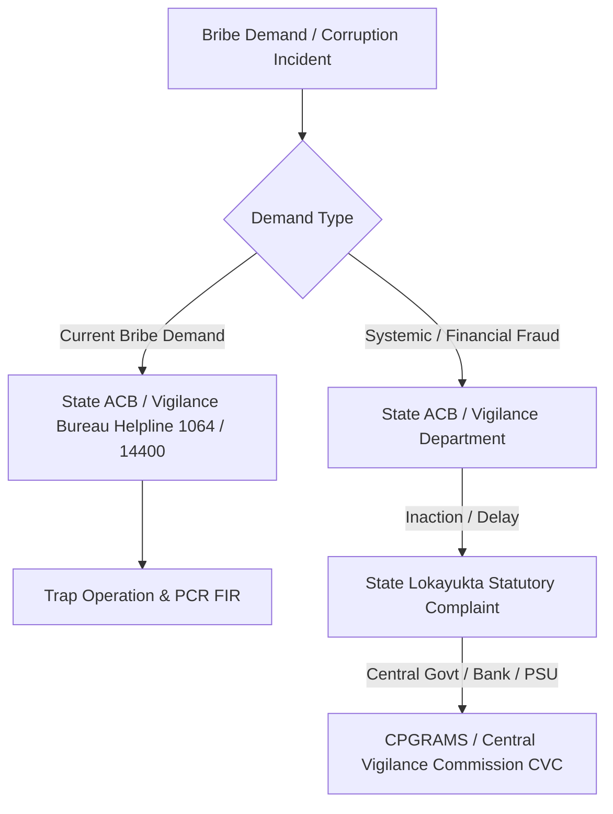

# 🇮🇳 JanVigil — India Anti-Corruption Directory

> **JanVigil** is an authoritative, open-source civic directory and interactive web portal covering official Anti-Corruption Authorities, complaint portals, toll-free helplines, anonymity rules, and escalation paths across all **28 States** and **8 Union Territories** of India.

[](https://mayurpise.github.io/JanVigil/)
[](https://opensource.org/licenses/MIT)
[]()
[]()

🌐 **Live Website**: [https://mayurpise.github.io/JanVigil/](https://mayurpise.github.io/JanVigil/)  
📦 **GitHub Repository**: [https://github.com/mayurpise/JanVigil](https://github.com/mayurpise/JanVigil)

---

## 📌 Context & Motivation

Not every State or Union Territory in India operates a functioning public online anti-corruption complaint web form. Many agencies accept complaints strictly through written postal communications, phone helplines, official email, or statutory Lokayukta bodies. Furthermore, relying on outdated static government PDF directories often leads citizens to dead links or inactive phone numbers.

**JanVigil** addresses this by maintaining individually verified, machine-readable datasets and an interactive citizen web dashboard.

> [!IMPORTANT]
> **Anonymous does NOT mean Protected.**
> - **Anonymous Tips**: Many agencies accept source tips for intelligence or preliminary inquiry, but unverified tip-offs rarely lead to formal prosecution. (For example, Andaman & Nicobar Islands explicitly states that complaints with unverified addresses are treated as pseudonymous and **no action is taken**).
> - **Formal Trap Complaints**: Catching an official accepting an active bribe demand requires an identifiable complainant (or authorized representative) to participate in laying trap evidence under the Prevention of Corruption Act.

---

## 🏛️ Directory Data

### Summary Breakdown

- **28 States**: Ranging from direct 24x7 ACB helplines (`1064`, `14400`, `1076`) to formal Lokayukta statutory affidavit requirements.
- **8 Union Territories**: Detailed jurisdiction coverage including GNCTD Delhi ACB (`1031`), Chandigarh CVO, J&K ACB (`1800-180-7152`), and island territory vigilance units.

Entries marked with an asterisk (`*`) in the data indicate numbers or online web forms that could not be independently confirmed on the agency's primary operational portal at the time of snapshot and rely on general administrative routing.

---

## 💡 Anonymous Tip vs. Confidential Complaint vs. Trap Complaint

| Type | Identity Disclosed? | Likelihood of Formal Investigation | Primary Purpose & Procedure |
| :--- | :---: | :---: | :--- |
| **Anonymous Tip** | No | Low to Medium | Intelligence gathering & background surveillance. |
| **Confidential Complaint** | Yes (Kept Secret) | High | Internal inquiry into systemic corruption, kickbacks, or disproportionate assets. |
| **Formal Trap Complaint** | Yes | **Very High (Immediate)** | Pre-arranged sting/trap by ACB/Vigilance to catch an officer accepting a bribe red-handed. |

---

## 🚀 Escalation Matrix

If you are facing active corruption or unresolved grievances, follow the recommended statutory escalation sequence:



---

## 📂 Repository Structure

```text
JanVigil/
├── data/
│   └── anti_corruption_directory.js  # Full dataset (28 States + 8 UTs)
├── src/
│   ├── main.js                        # App state, filters, search, & dynamic render logic
│   └── style.css                      # Modern light/dark theme & responsive UI components
├── index.html                         # App root HTML
├── CONTRIBUTING.md                    # Data update guidelines for community
├── LICENSE                            # MIT License
├── package.json                       # Vite bundling script configuration
└── README.md                          # Documentation & overview
```

---

## 💻 Running the Web Portal Locally

Prerequisites: Node.js (v18+)

```bash
# Clone the repository
git clone https://github.com/mayurpise/JanVigil.git
cd JanVigil

# Install dependencies
npm install

# Start local development server
npm run dev
```

---

## 🤝 Contributing

We welcome updates from legal practitioners, journalists, RTI activists, and citizens. If a phone number, helpline, or online portal URL changes in your State or UT:

1. Review [CONTRIBUTING.md](file:///home/mayurpise/workspace/JanVigil/CONTRIBUTING.md).
2. Submit a Pull Request updating `data/anti_corruption_directory.js` with official state portal citations.

---

## 📜 Disclaimer

*JanVigil is an open-source civic directory compiled from public government web portals and statutory declarations. It is provided for informational and educational purposes. In an active emergency or bribe demand, contact your nearest Anti-Corruption Bureau station or dial the official toll-free helpline directly.*
